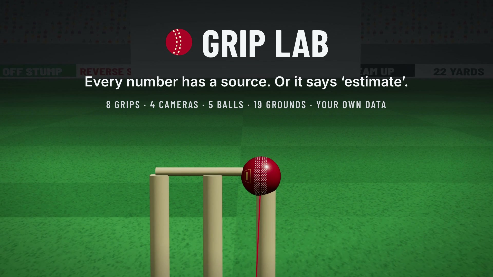

# Grip Lab

Photograph a cricket ball grip, confirm which grip it is, and watch the delivery in 3D from the bowler's,
batter's and umpire's view. The full brief is in `SPEC.md`.

**Try it:** [grip-lab-sable.vercel.app](https://grip-lab-sable.vercel.app) · **Launch video:** [brag.mp4](https://github.com/ShantanuTaro/grip-lab/releases/download/v0.1.0/brag.mp4)



Grip recognition from photos is experimental (see [Status](#status)). The simulator is the part to try first.

## Status

**Works:** the simulator (3D scene, four cameras, playback, live delivery controls in a coach's words, the five match balls, pitch map), the capture screen,
the labelling tool with JSON export, the physics engine, and the tool that fits the physics to tracked
deliveries, checked on real Hawk-Eye tracking from 214 Tests. That tracking also sets the stock bounce, the famous
grounds' bounce and how a pitch loses it over a match (see [Real tracking data](#real-tracking-data)).

**Works, but is not accurate yet:** grip recognition. A general vision model on Groq's free tier gives a
first guess; on the three public photos tried, its top pick was wrong each time. The on-device engine
runs but cannot name a grip until photos have been labelled. See [Grip recognition](#grip-recognition).

**Not done:** fitting grip, seam, swing and drag to real tracking (the public feed has no seam angle, spin,
release point or post-bounce speed, so only the bounce is fitted), and anything that needs a server once the
app is deployed.

## Setup

Needs Node 24 or newer.

```
npm install
npm run dev          # the app, at http://localhost:5173
npm test             # 43 tests: physics, the balls, the coach words, the fitter (simulated and real tracking), the Groq reply checker, the on-device measurements
npm run typecheck
npm run build        # type-check, then a production build in dist/
npm run fit -- --demo
npm run eval -- grip-labels.json
```

**Groq key.** Grip matching and reading pasted pitch notes need a free key from console.groq.com in `.env.local`:

```
GROQ_API_KEY=gsk_...
```

`.env.local` is in `.gitignore`. The key stays on the dev server, which adds it to requests on their way
to Groq; it is never sent to the browser. Restart `npm run dev` after changing it. Without a key the
capture screen falls back to sample data and says so.

**On a phone.** Run `npm run dev -- --host` and open the Network address it prints. Anyone on the same
Wi-Fi who opens that address can use your Groq quota, so do this on a network you trust.

**Deploying.** `npm run build` makes a static site. It has no server, so Groq matching will not work
there until a small server function holds the key. The host must also serve `index.html` for
`/simulator`, `/grounds`, `/capture` and `/label`.

## The screens

| Route | What it does |
|---|---|
| `/simulator` | Grip library, the ground (famous grounds or your own data, day of the match, dew), the 3D view with Bowler / Batter / Umpire / Ball cameras (Ball first) and a pitch map in its corner, playback with a speed slider (0.05× to 1×, starting at a quarter of real time), five readouts and the delivery controls, in a coach's words ([below](#the-delivery-controls)). On laptops and desktops it fits the window. On a phone the extra controls are in a bottom sheet. |
| `/grounds` | My grounds: a team's own pitches, built from pasted notes (read by AI), measurements and tracked deliveries. Saved grounds can be bowled on, edited or deleted. |
| `/capture` | Up to three photos (side on, seam front on, release position), what the matcher sees, its three closest grips, and a confirm step. Nothing is simulated until a grip has been picked by hand. |
| `/label` | Add photos, say which grip and angle each shows, and export the set as JSON. Photos confirmed on the capture screen land here too. |

Things worth knowing:

- The ball is drawn 1.67 times life size so it can be seen from 20 m. The physics and the
  stumps verdict use the true size, so a near miss can look like a hit on screen.
- The Ball view is the exception. Its camera rides 1.5 m behind the ball, which is drawn at true size, so
  the seam and the spin can be seen and a near miss looks like one. It follows only part of the ball's
  sideways movement, so swing and turn show as the ball moving across the picture. Its framing is in
  `FOLLOW` in `src/scene/Scene.tsx`.
- The seam on the ball follows the simulated spin: square to the spin axis for a spun ball, upright and
  turned by the seam angle for a seam ball.
- Labelled photos are kept in the browser (IndexedDB) on that device. Clearing site data deletes them,
  so export regularly.
- With "reduce motion" set on the device, nothing plays or glides unless Bowl is pressed.
- "Use the demo photos" on the capture screen fills the three slots from the project root: `photo1.jpeg`
  (seam, front on), `photo2.jpeg` (side on) and `photo3.jpeg` (release position). Swap those files to change
  the demo; the app will not build without all three. `npm run build` copies them into `dist/`, so they
  are public wherever the build is deployed. Demo photos are not kept for the training set unless the box
  is ticked.

## The delivery controls

Nobody at a club knows a ball's revs, or its seam angle in degrees, so the controls ask in a coach's words and
set the numbers from measurements of real bowlers. Each number shows beside its word. "Exact numbers" opens
the sliders for anyone with a speed gun, a smart ball or tracking. The values and their sources are in
`src/physics/grips.ts`.

| Control | In words | Numbers | From |
|---|---|---|---|
| Revs (spin grips) | Club, Academy, Elite, Big spinner | finger spin 1,100 / 1,500 / 1,700 / 2,000 rpm; wrist spin 1,550 / 1,800 / 2,200 / 2,500 | spinners from club to England squad, measured in the lab (Beach 2012, Chin 2009, Justham 2008, Keith 2012, Sanders 2018 and 2019). The level stays when the grip changes. |
| Count them | the frames a slow-motion video takes for three turns | rpm = frames a second × 180 ÷ frames | how Keith et al. measured a leg-spinner, with a dot on the ball |
| Spin (spin grips) | Over-spin, Usual, Side-spin | the grip's measured spin axis, turned 20° either way | Beach 2012: off-spinners 59° from pure over-spin on average, leg-spinners 40° |
| Seam (seam grips) | to fine leg, upright, to slips; a little, typical, a lot | 10°, 22°, 30° | swing bowlers measured at 21–25°, within 10–30° (Lindsay & Spratford 2021); swing peaks near 20° |
| Wobble seam | steady or wobble seam | no swing; lands anywhere within 30° of upright, different each time Bowl it starts a new ball | the seam rocks between about 11 and 1 o'clock (Wisden, "The story of the wobble seam"); nothing has measured it, so the size is an estimate |
| Match a ball you saw | how far it swung (seam grips) or turned by the stumps (spin grips), in cm | the seam angle or revs that give it, at the speed, ball and ground as set | worked back through the simulator (`src/physics/match.ts`); it says so when no setting can give what was typed |
| Time it on a video | frames from the hand to the far stumps, at the video's frame rate | the release speed that takes that long, at the length as set | worked back through the simulator |
| Bowler's height | cm | release at 111% of it | county fast bowlers (Manawadu 2023); 2.1 m is a 1.89 m bowler |
| Over or round the wicket | | release 0.4 m or 0.9 m from middle stump | 0.4 m from the brief; 0.9 m is an estimate, as I found no measurement |
| Length | Yorker to Short, with spinners' own bands | pace: full to 6 m, good length 6–8, back of a length 8–9; spin: good length 3.5–5.5 | The Cricket Monthly's Hawk-Eye bands; Test spinners pitch half their balls 3.7–5.1 m out ([the Hawk-Eye file](#real-tracking-data)) |
| Line | Leg, Middle, Off, 4th, 5th | the stumps are 9.5 cm apart | Law 8 |
| Release speed | kph or mph (the switch at the top of the panel, kept in the browser), with Test averages beside it | fast seamers 136 kph, medium 130, spinners 83–86 | [the Hawk-Eye file](#real-tracking-data) |
| Ball | Kookaburra, Dukes, SG, Pink, White; new or old | New, it swings the usual way up to 138 kph (Kookaburra, SG, White), 144 (Pink) or 152 (Dukes), then reverses. Old, every ball reverses from 125 kph; a Kookaburra reverses 25% harder than a Dukes and a pink 25% less, and a Kookaburra-made seam moves 30% less off the pitch | wind tunnels at Bath (Scobie 2020) and Cambridge (Grimshaw 2024), averaged where both measured a ball; Deshpande 2018 for the SG. The 30% is an estimate. Details in `BALLS`, `src/physics/constants.ts` |

"Seam pointing at first slip" is a figure of speech: from the bowler's hand first slip is only about 5° off
line, while swing bowlers angle the seam about 20°. The "Off the pitch" readout gives the turn in cm at the
stumps, with the angle TV quotes beside it. Three changes from the brief: the off-break spins at the elite
average, 1,700 rpm, instead of 2,000; the spin slider runs to 3,000 rpm instead of 2,500, so a counted
elite wrist-spinner fits (the fastest measured, 2,553); and the speed slider runs from 60 to 160 kph instead
of 70 to 150, so a junior or a timed express bowler fits.

The studies are small, 10 to 23 bowlers each. Club bowling speeds have no good source, so speed stays a number.

**The balls, checked against match tracking.** Over Test seamers' speeds (134 ± 6 kph), lengths of 5.5 to 7.5 m and a
quarter of balls new, with the seam at 22°, the simulator swings a Dukes 1.00° on average and a Kookaburra 0.79° (the
angle the ball turns through between hand and pitch, as TV quotes it). CricViz measured 0.97° to 1.15° in Tests in England
and 0.7° in Tests in Australia, red ball or pink. In Australia the pink swung more than the red for about 30 overs and
less after; so does the simulator's (1.63° against 1.01° new, 0.44° against 0.72° old). The match figures include each
country's weather and bowlers, which the ball alone does not explain. In the Sheffield Shield, which used both balls on
the same grounds, pace bowlers took 85% of the dismissals with the Dukes and 76% with the Kookaburra (Connor et al. 2019).
The ball starts as the Kookaburra, the one most Tests and every white-ball international use; with it the stock
outswinger swings 16 cm, against 25 cm before the balls were modelled and 31 cm with a Dukes.

## Your own ground data

The My grounds screen (`/grounds`, also reached from the Ground card in the simulator) has four ways in, used in this order of trust:

1. **Tracked deliveries** (CSV, template in the form): the ground's bounce, grip, seam and swing are fitted to
   them, in that ground's air and wind (`src/ground/tracked.ts`, using `src/physics/fit.ts`). A setting the
   data cannot pin down is left alone, the others are fitted again without it, and the form says so. A
   measured value no real ball could produce (exports contain heights at the stumps of −60,987 m) stops
   the file with its row named. "Try real Hawk-Eye data" loads 100 real tracked balls from Tests at the
   Gabba, Lord's or Mohali (`src/ground/demo/`; see [Real tracking data](#real-tracking-data)).
2. **Measurements**: the ECB pitch-monitoring tests (drop rebound, Clegg hardness, speed kept, grass, moisture,
   damage, spread of hardness) and the weather (temperature, humidity or dew point, wind, cloud, altitude).
   How each becomes a setting is in `src/physics/measurements.ts`, with its source or marked as an estimate.
3. **Pasted notes**: a language model fills in the measurement fields, quoting the words behind each number
   and marking inferences as guesses, for a person to check (`src/ground/ai.ts`). It never sets the physics
   itself. This sends the pasted text to Groq; swap the provider in that file.
4. Anything left blank comes from the ground it starts from.

Saved grounds live in this browser's storage only. Tracked files are read in the browser and not stored.

## Where things are

```
src/physics/     constants.ts (every coefficient, and the five balls), grips.ts (the eight presets and the coach words), simulate.ts, fit.ts,
                 match.ts (works back from what a coach saw to the seam angle, revs or speed),
                 venues.ts (grounds, match wear, cracks, dew), measurements.ts (team measurements to settings)
src/ground/      tracked.ts (CSV of tracked deliveries, per-ground fit), ai.ts (pasted notes to measurements),
                 demo.ts + demo/ (real Hawk-Eye tracking to try in the form)
src/scene/       Scene.tsx: ball, path, cameras, bloom and tone pass. World.tsx: floodlit ground and stadium (all generated, no asset files)
src/screens/     Simulator.tsx, Grounds.tsx + GroundData.tsx (My grounds and its form), Capture.tsx, Label.tsx
src/vision/      classify.ts (the interface), groq.ts, device.ts (Phase B scaffold), labels.ts (training set)
src/store.ts     app state (Zustand): the delivery, its result, playback, captured photos
scripts/         fit.ts (fit physics to tracking data), eval-grips.ts (score the Groq matcher),
                 hawkeye/ (rebuild the numbers taken from real tracking)
```

## Grip recognition

Everything goes through one function, `classifyGrip(images, engine)` in `src/vision/classify.ts`. It
returns what the photos show (seam, fingers, thumb, hand) and up to three grips with a confidence
each. The confidence is the engine's own estimate and has not been checked against outcomes. There
are three engines:

**Groq vision model.** Sends the photos to `qwen/qwen3.8-27b`, the one model on Groq's free tier that
accepted images when checked on 2026-11-11. The prompt in `groq.ts` describes the eight grips; the
reply is checked before use (unknown grips dropped, numbers clamped).

- Limits seen on the free tier: 7,000 input tokens a minute at 2,048 per photo, so one three-photo check
  a minute, and 1,000 requests a day. Three photos per request at most. When the limit is hit the app
  says how long to wait.
- Groq's documentation says request data is not retained by default, and that logs may be kept for up to
  30 days to investigate faults or abuse. The page did not say whether data is used for training.
- Results so far, which are too few to mean much: scored one photo at a time on three public photos
  (two of an inswinger grip, one of a leg-spinner's), the top pick was wrong all three times and the true
  grip was in the top three for two. Given both inswinger photos together it picked inswinger.

**On this device (Phase B scaffold).** `device.ts` runs in the browser, so photos never leave it:

1. MediaPipe Hand Landmarker finds 21 points on the hand. The model and its runtime are downloaded
   from Google and jsDelivr the first time.
2. A seam finder looks for pale stitching on a red ball and measures which way it runs.
3. A nearest-neighbour vote compares those measurements with the photos labelled under `/label`.

What was found when trying it: the hand tracker found the hand in two of six photos, both of them
colour photos taken from an arm's length. It missed three tight close-ups, where the ball hides the
palm, and a 1934 black-and-white photo. On the two photos with a clear seam
the seam finder was roughly 10° and 25° off the angle judged by eye. With no labelled photos, step 3
has nothing to vote with. None of the thresholds has been tuned.

**Sample data.** The Phase A stub: fixed output, marked as sample data wherever it appears.

### Building and using the training set

No public set of labelled grip photos exists. `/label` collects one and exports a file like this:

```json
{
  "format": "grip-lab-labels",
  "version": 1,
  "exportedAt": "2026-11-11T14:40:00.000Z",
  "photos": [{ "id": "…", "gripId": "inswinger", "view": "side", "addedAt": "…", "dataUrl": "data:image/jpeg;base64,…" }]
}
```

`npm run eval -- that-file.json` sends each photo to Groq on its own and reports how often the top pick
and the top three were right, grip by grip. On the free tier that is two photos a minute. Aim for at
least ten photos per grip, shot from an arm's length, before trusting the percentages.

## Using the physics

```ts
import { delivery } from './src/physics/grips.ts';
import { simulate } from './src/physics/simulate.ts';

const result = simulate(delivery('outswinger', { speedKph: 128, lengthM: 6 }));
// result.points       ball position every millisecond
// result.bounce       where and when it pitched
// result.swingCm      movement in the air; + is away from the batter
// result.deviationDeg change of direction off the pitch; + is into the batter
// result.timeToStumpsS, result.speedAfterBounceKph
// result.atStumps     position at the batter's stumps and the verdict
```

One simulation takes under a millisecond, so sliders can redraw the path live.

### Directions

| Thing | Convention |
|---|---|
| `z` | down the pitch: 0 at the bowler's stumps, 20.12 m at the batter's |
| `y` | height above the pitch |
| `x` | across the pitch; `+x` is the bowler's left, the off side for a right-hander |
| Seam angle | `+` points at the slips and swings away from the batter |
| Spin | `+` turns into the batter (off-break), `−` turns away (leg-break) |
| Line | cm from middle stump where it pitches; `−` is off, `+` is leg |
| Length | metres from the batter's stumps where it pitches |

Seam, spin, line and the results are relative to the batter, so a left-hander needs only `batter: 'left'`.
The axes are right-handed and match three.js, so positions can be drawn without conversion.

## The physics model

The flight is integrated with fourth-order Runge-Kutta at a 1 ms step. Four forces act on the ball:

- **Gravity.**
- **Drag**, with a constant drag coefficient.
- **Magnus force** from the spin vector. Only spin at right angles to the flight produces it. Topspin makes
  the ball dip, backspin makes it carry, and spin about the vertical axis makes it drift sideways.
- **Seam swing**, a sideways force that depends on seam angle, speed, the ball and its condition. It peaks with
  the seam near 20°. It fades as speed rises and then reverses: above 138 to 152 kph for a new ball, depending on
  which ball (see [the delivery controls](#the-delivery-controls)), above about 125 kph for an old one. The force
  follows the ball's current speed, so a quick ball that slows into the swing band moves late.

**The bounce** treats the ball as a rigid sphere with restitution (how much vertical speed survives) and
sliding friction. Friction acts against the motion of the point touching the pitch. That one rule gives the
loss of pace, the turn from side spin, the extra kick from topspin and the topspin every ball picks up from
the pitch. An angled seam adds a small kick in the direction it points.

**Each grip has a spin axis**, not only a rev rate: a split between side spin (turn), topspin or backspin,
and drift. This is what separates a googly from an off-break. The off-break's and leg-break's were measured
on real spinners (Beach, Ferdinands & Sinclair 2012); the googly's and the cutters' are estimates.

**Release angles are solved**, not set: the simulator finds the launch direction that pitches the ball on
the requested length and line, accurate to a fraction of a millimetre.

### Assumptions and known gaps

- The drag coefficient is constant. A real ball's changes with speed and seam position.
- The Magnus curve comes from baseball measurements. I found no cricket-specific curve.
- Pace grips carry no backspin unless you add it. Real seam bowlers put backspin on the ball, which holds
  the seam steady and gives a little lift.
- Seam swing is applied even when the ball is also spinning hard. In reality heavy side spin scrambles the
  seam and reduces swing.
- Seam swing stops at the bounce, on the assumption that pitching disturbs the seam.
- A wobble seam is modelled as no swing at all and a seam that lands at a random angle up to 30° either side
  of upright. Real wobble-seam balls can still swing a little when the wobble is slight.
- "New" and "old" are two curves, which each ball slides to its own reverse speed. A real ball changes over by
  over and its two sides wear separately. Humidity is not modelled; wind tunnels found it makes no difference.
- No wind tunnel has measured a red Kookaburra or a new pink one: they take the white Kookaburra's and the pink
  Dukes' figures. The two labs that measured the Dukes and the Kookaburra disagree on the gap between them (26 kph
  of reverse speed at Bath, 2 at Cambridge); the average is used.
- Every ball bounces and grips the same. Accounts of hardness and of the grip spinners get from each seam
  differ, and I found no measurement.
- The grounds' swing figures are reputations, which may already include the local ball: a Dukes at Headingley
  may count the ball twice.
- One pitch: restitution and friction are single numbers. Real pitches differ, and change through a match.
- Spin does not decay in flight.
- Release is above the popping crease at 111% of the bowler's height (2.1 m unless set), measured on pace
  bowlers and used for spinners too. It is 0.4 m to the side over the wicket and 0.9 m round it (an
  estimate). A tracked delivery can override it.
- A ball that runs out of bounce rolls the rest of the way, slowed only by the air.

## The constants and how to tune them

Every number is in `src/physics/constants.ts`, each with a comment giving its source or saying it is an
estimate. The grip presets are in `src/physics/grips.ts`.

Six coefficients can be fitted to data:

| Coefficient | Default | What it controls | Basis |
|---|---|---|---|
| `dragCd` | 0.45 | how fast the ball slows in the air | brief; ~0.5 for most balls (Cross) |
| `magnusScale` | 1 | strength of drift and dip from spin | estimate (baseball curve) |
| `swingCsMax` | 0.25 | peak seam swing | estimate inside Mehta's measured range |
| `restitution` | 0.631 | bounce height | fitted to 6,420 Hawk-Eye balls from 214 Tests, on day 1 (brief: 0.55); varies by pitch |
| `friction` | 0.35 | pace lost and turn gained at the bounce | estimate; varies by pitch |
| `seamKickDegPerDeg` | 0.03 | movement off the seam | estimate, no published source |

The two swing curves (`SWING_VS_SPEED`, `SWING_VS_SEAM_ANGLE`) are tables edited by hand; the speed table is in kph
past each ball's reverse speed (`BALLS`), so one table serves all five balls. Wind-tunnel
results and match tracking disagree about how fast a new ball can still swing conventionally, so the
speed table is the first thing to revisit with real data.

### Fitting to tracked deliveries

```
npm run fit -- deliveries.json                    # fit all six
npm run fit -- deliveries.json dragCd,friction    # fit only these
npm run fit -- --demo                             # see it work on simulated tracking data
```

The file lists deliveries. Each has the inputs the tracker knows and whichever results it measured:

```json
{
  "sigma": { "heightAtStumpsCm": 3 },
  "deliveries": [
    {
      "delivery": {
        "speedKph": 134, "seamAngleDeg": 0, "spinRpm": 0, "lengthM": 6.2, "lineCm": -10,
        "arm": "right", "batter": "right", "ball": "new",
        "release": { "x": 0.45, "y": 2.05, "z": 1.5 }
      },
      "observed": { "timeToBounceS": 0.36, "speedAfterBounceKph": 108, "heightAtStumpsCm": 61 }
    }
  ]
}
```

`release`, `spinAxis` and `sigma` are optional. `sigma` is the measurement noise of each metric; the
defaults in `fit.ts` are estimates of tracker precision.

What each measurement can pin down:

| Measurement | Fits | Needs |
|---|---|---|
| `timeToBounceS` | `dragCd` | nothing else |
| `speedAfterBounceKph` | `friction` | nothing else |
| `heightAtStumpsCm` | `restitution` | nothing else |
| `swingCm` on spun balls | `magnusScale` | spin rate and axis for each ball |
| `swingCm` on seam balls | `swingCsMax` | seam angle for each ball |
| `deviationDeg` | `friction`, `seamKickDegPerDeg` | spin or seam angle for each ball |
| `timeToStumpsS`, `lineAtStumpsCm` | help all of the above | |

A tracker that reports only the ball's path can fit drag, restitution and friction. Swing and spin
strength need the seam angle and spin of each ball, which most trackers do not record.

The command reports each fitted value with its uncertainty. A coefficient the data cannot pin down is
left at its default and the report says why. To adopt a result, paste the printed lines into
`DEFAULT_COEFFS` and note the dataset in the comment.

It has been run on real Hawk-Eye tracking: see the next section.

## Real tracking data

Ball tracking is sold, not published. The one open copy found is
[HawkeyeStats](https://github.com/alittlefitness/HawkeyeStats): the ICC match-centre feed for Tests, ODIs and the
IPL to 2021, tidied into CSV. **It carries no licence; the tracking belongs to Hawk-Eye and the ICC.** The demo files
bundle 300 of its balls, credited to Hawk-Eye and the ICC; no ownership of the tracking is claimed.

For each ball it gives the bowler's arm and style, the batter's hand, the release speed, where the ball pitched and
where it passed the stumps. It has no seam angle, spin, release point or speed after the bounce, so of the four
pitch settings only the bounce can be fitted from it.

**How the men's Test file (527,165 balls, 317 matches) was prepared** (`scripts/hawkeye/prepare.py`; to run it, see
[Rebuilding the numbers](#rebuilding-the-numbers)).

1. **Grounds.** The feed has match ids, not grounds. Each match was paired with its [Cricsheet](https://cricsheet.org)
   scorecard (open data) by the players' surnames, then by the order the batters were out, innings by innings.
   279 matches paired with dismissal orders at least 80% alike and no scorecard claimed twice. The other 38 were dropped.
2. **Directions, read off the data.** `pitchX` and `stumpsX` are absolute and negative toward a right-hander's off side:
   right-arm bowlers pitch a median 38 cm that side of middle to right-handers (93% of balls), and left-arm bowlers 31 cm
   the other side to left-handers. So `lineCm = off × pitchX × 100`, with off +1 for a right-hander and −1 for a
   left-hander; the same for `lineAtStumpsCm`. (The one paper found using this feed states the opposite sign.)
   `pitchY` is metres from the stumps, like `lengthM`; `stumpsY` is the height at the stumps.
3. **Kept:** seam bowlers' balls with speed, pitch and stumps all tracked, 25 to 45 m/s, pitching 0.5 to 16 m out,
   passing the stumps 0 to 3 m up: 181,951 balls. 71 were tracking glitches (heights such as −60,987 m) and 872 did
   not pitch 0.5 to 16 m out, mostly full tosses. Seam angle and spin are entered as 0: the feed does not have them.
   Each ball's day of the match is estimated from the overs bowled before it, at 90 a day.
4. **Checked against published Hawk-Eye figures** (N. Leamon, "What is the best length to bowl in Tests?",
   *The Cricket Monthly*, 2018), which tests the directions and units above:

   | Where it pitched | under 5 m | 5–6 m | 6–8 m | 8–9 m | over 9 m |
   |---|---|---|---|---|---|
   | Share of balls, Leamon | 10% | 13% | 43% | 15% | 7% |
   | Share of balls, this data | 11.5% | 13.5% | 44.0% | 14.8% | 16.3% |
   | Would hit the stumps in England, Leamon | 28% | 22% | 10% | 2% | 1% |
   | Would hit the stumps in England, this data | 26.2% | 22.5% | 9.6% | 2.0% | 0.2% |

   Only the share over 9 m disagrees. Leamon's shares add up to 88%, so that band may leave some balls out (this
   data has 8.3% at 9 to 10.5 m). CricViz reported 93 cm of bounce from good-length balls at Perth Stadium in
   ODIs as the 11th highest of any match since 2005 (*Hindustan Times*, 14 December 2018); here the 11th highest
   Test averages 90 cm, and the median Test 78 cm.

**What the app made of it** (`scripts/hawkeye/fit.ts`: each ball simulated on its day of the match, fitted to its
height at the stumps).

- With the brief's restitution of 0.55, the model put these balls a median 16 cm lower at the stumps than Hawk-Eye
  saw them, from 1 cm for yorkers to 28 cm for bouncers. Every bouncy ground's fit hit the top of restitution's
  range, and the form said "Bounce: the tracking could not pin it down".
- **The bounce falls through a Test, by 5% rather than the guessed 12%.** On the 61 Tests that reached day 5, 20 balls
  a day from each, restitution fitted to each day's balls on their own fell 3% from day 1 to day 2 and 5% by day 5.
  With the rest of `wear()` in place, a 5% fall by day 5 fits best and 12% fits clearly worse, so `wear()` now uses 5%.
- 6,420 of the balls (30 spread through each of 214 Tests at 61 grounds), each on its day, give the standard pitch a
  day-1 restitution of 0.631 ± 0.001, now the default. The misfit is then within 3 cm at every length (6 cm for
  bouncers). Adding 800 or 1,500 rpm of backspin to the pace balls, which the model lacks, fitted worse, so it was
  not added.
- Ground by ground (40 balls a Test, the 37 grounds with 3 or more tracked Tests, ± 0.4 to 1.2%), the bounce runs from
  the WACA and the Gabba (120%), Adelaide (115%), Sydney and Melbourne (113%), through Lord's (101%), to Abu Dhabi
  (92%), Delhi (91%), Nagpur (88%) and Mohali (86%). Each ground `venues.ts` has is fitted in its own air, wind, slope
  and grip. At the 16 that have tracking, `venues.ts` now takes its bounce from these fits; before, it held a reading
  of each ground's reputation:

  | | Gabba | SCG | MCG | Headingley | Newlands | Oval | Kensington | Sabina | Wanderers | Lord's | Trent Br. | Galle | Chennai | Wankhede | Eden | Dubai |
  |---|---|---|---|---|---|---|---|---|---|---|---|---|---|---|---|---|
  | Hawk-Eye, now in `venues.ts` | 120 | 113 | 113 | 106 | 106 | 105 | 103 | 103 | 103 | 101 | 100 | 98 | 97 | 97 | 95 | 94 |
  | Reputation, before | 110 | 100 | 95 | 95 | 105 | 105 | 105 | 112 | 112 | 100 | 100 | 85 | 88 | 108 | 95 | 82 |

- **Held out.** Fitted to a ground's earlier Tests, the bounce predicted its last two Tests (23 grounds with 4 or more)
  with a typical error of 15.5 cm, against 16.9 cm for the standard pitch: better at 14 grounds, the same at 1 and
  worse at 8. At the 14 of them that `venues.ts` has, the reputations did worse than either (18.6 cm, against 16.2
  fitted and 17.3 standard). Where the fit lost, the pitch had changed: good-length balls passed the Wanderers' stumps
  at 75 to 82 cm in 2013 and at 90 to 92 cm in 2016 and 2017.
- Grip, seam and swing could not be pinned down at any ground, and the form says so: heights alone cannot tell grip
  from bounce, and seam and swing need each ball's seam angle.

**Limits.** The release point is not in the feed, so the model's (2.1 m up, 0.4 m wide) stands in: a ground where
taller bowlers bowled looks bouncier. For a ball the batter hit, the height at the stumps is Hawk-Eye's own
projection. Seamers only: spinners need spin rates the feed lacks. A ball's day is counted from the overs bowled, so
after rain it can read a day too early. The Tracking tab's CSV has no day column, so its fit is an average over the match, a percent or
two under the day-1 figure. Each fit runs in the browser's main thread, about a second per 50 balls on a laptop.

### Rebuilding the numbers

The tracking is not in the repo (no licence). With Python 3 and Node:

```
curl -L -o mensTest.csv https://raw.githubusercontent.com/alittlefitness/HawkeyeStats/main/mensTestHawkeyeStats.csv
curl -LO https://cricsheet.org/downloads/tests_json.zip && unzip -q tests_json.zip -d tests
python3 scripts/hawkeye/prepare.py mensTest.csv tests out   # out/pace.csv, out/demo/, and the checks above (seconds)
node scripts/hawkeye/fit.ts out/pace.csv wear               # the fall through a match, for wear() (4 minutes)
node scripts/hawkeye/fit.ts out/pace.csv restitution        # the day-1 default, for constants.ts (3 minutes)
node scripts/hawkeye/fit.ts out/pace.csv grounds            # each ground, for venues.ts, and the held-out check (1 minute)
```

Each prints its result beside the value in the code. `out/demo/` should match `src/ground/demo/`. The numbers above
come from the copies downloaded on 15 November 2026; a newer copy of either file can move them a little.

## Sources

- R. Cross, *Sports ball aerodynamics*, University of Sydney: drag, air density, seam angle and reverse-swing speeds.
- R. Mehta, *An overview of cricket ball swing*, Sports Engineering 8 (2005): swing against speed and seam angle.
- Deshpande, Shakya & Mittal, *The role of the seam in the swing of a cricket ball*, J. Fluid Mech. 851 (2018), doi:10.1017/jfm.2018.474: new and rough balls, and the SG ball's reverse speed.
- Scobie, Shelley, Jackson, Hughes & Lock, [*Practical perspective of cricket ball swing*](https://doi.org/10.1177/1754337119872874),
  Proc. IMechE P (2020): new red and pink Dukes and a new white Kookaburra, and worn Dukes and pink Kookaburras, in one wind tunnel.
- Grimshaw, Briggs & Atkins, [*A review and reassessment of the aerodynamics of cricket ball swing*](https://doi.org/10.1017/flo.2024.4),
  Flow 4, E6 (2024): the published measurements side by side, and new ones of each make, new and roughened.
- S. Pradhan, [*How Kookaburra balls came to rule the world*](https://www.thecricketmonthly.com/story/1160615/how-kookaburra-balls-came-to-rule-the-world),
  The Cricket Monthly (2018): how each maker stitches the seam.
- A. Chopra, [*Decoding the SG and Kookaburra*](https://africa.espn.com/cricket/story/_/id/22065703/decoding-sg-kookaburra), ESPNcricinfo (2009): how the seams wear.
- CricViz, [*Swing Kings*](https://cricviz.com/swing-kings/) (2020) and B. Jones, [*Turning off the lights*](https://cricvizanalyst.substack.com/p/turning-off-the-lights)
  (2025): average swing in Tests in England and Australia, and the pink ball against the red.
- Connor, Sinclair, Leicht & Doma, [*Analysis of cricket ball type and innings on state level cricket batter's performance*](https://doi.org/10.3389/fpsyg.2019.02347),
  Frontiers in Psychology (2019): Sheffield Shield seasons played half with each ball.
- James, Carré & Haake, *Predicting the playing character of cricket pitches*, Sports Engineering 8 (2005): the bounce model.
- Laws of Cricket (MCC), Laws 4, 6, 7 and 8: ball and pitch dimensions.
- Hawk-Eye tracking of men's Tests, 2012 to 2021, from the ICC match-centre feed as collected at
  [github.com/alittlefitness/HawkeyeStats](https://github.com/alittlefitness/HawkeyeStats) (no licence given).
- [Cricsheet](https://cricsheet.org) Test scorecards (ODC-BY): the ground and date of each tracked match.
- N. Leamon, [*What is the best length to bowl in Tests?*](https://www.thecricketmonthly.com/story/1154076/what-is-the-best-length-to-bowl-in-tests),
  The Cricket Monthly (2018): Hawk-Eye lengths and stumps-hitting rates, used to check the data, and the length bands.
- Beach, Ferdinands & Sinclair, [*Measuring spin characteristics of a cricket ball*](https://ojs.ub.uni-konstanz.de/cpa/article/view/5268),
  ISBS (2012): spin rates and axes of club and state spinners, and the earlier studies by level (Justham, West & Cork 2008; Chin et al. 2009).
- Keith, Britton & Liow, [*Dip and drift in spin bowling*](https://people.eng.unimelb.edu.au/imarusic/proceedings/18/287%20-%20Liow.pdf),
  18th Australasian Fluid Mechanics Conference (2012): a leg-spinner's revs, counted on high-speed video.
- Sanders, Felton & King, [*Kinematic parameters contributing to the production of spin in elite finger spin bowling*](https://repository.lboro.ac.uk/articles/journal_contribution/Kinematic_parameters_contributing_to_the_production_of_spin_in_elite_finger_spin_bowling/9610757),
  J. Sports Sciences 36 (2018); and L. Sanders, [*Factors affecting performance in elite finger spin bowling*](https://www.whit.com.au/cleanbowled/cricket-biomechanics/spin-bowling-and-batting/2019-sanders-phd-finger-spin-performance/),
  PhD thesis, Loughborough (2019): elite finger- and wrist-spin revs, Test spinners' turn.
- Lindsay & Spratford, [*A kinematic comparison of conventional inswing and outswing bowling*](https://commons.nmu.edu/isbs/vol39/iss1/10),
  ISBS (2021): measured seam angles. Read from the abstract and summaries; the full text was not reachable.
- Wisden, [*The story of the wobble seam*](https://wisden.com/cricket-features/long-read-the-story-of-the-wobble-seam-the-ball-that-changed-cricket):
  how the seam rocks, and CricViz's 0.75° threshold for real seam movement.
- Manawadu, PhD thesis, Loughborough (2023), and Felton et al. (2019), as summarised at
  [whit.com.au](https://www.whit.com.au/cleanbowled/cricket-biomechanics/fast-bowling-variations-and-loading/2023-manawadu-phd-fast-bowling-variations/):
  release height as a share of the bowler's height.

## Licence

Copyright (c) 2026 ShantanuTaro. Released under the [PolyForm Strict License 1.0.0](LICENSE): you may read the code and
run it for personal, study or other noncommercial use. You may not change it, build on it, redistribute it or use it
commercially. For any other use, ask the author. The Hawk-Eye tracking in `src/ground/demo/` is not covered by this
licence; it belongs to Hawk-Eye and the ICC.
